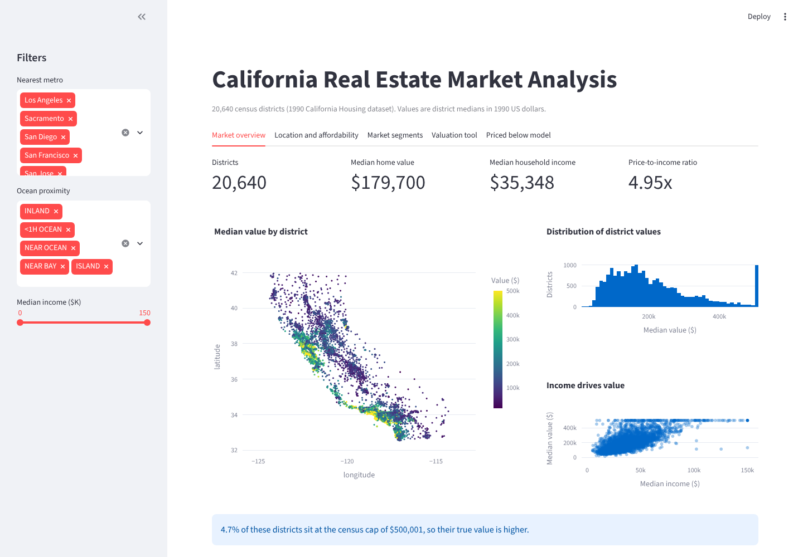
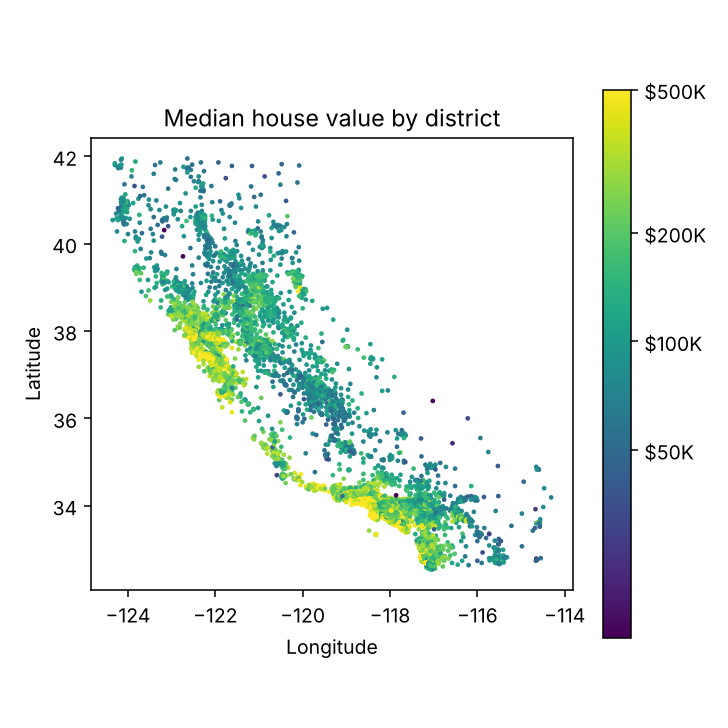
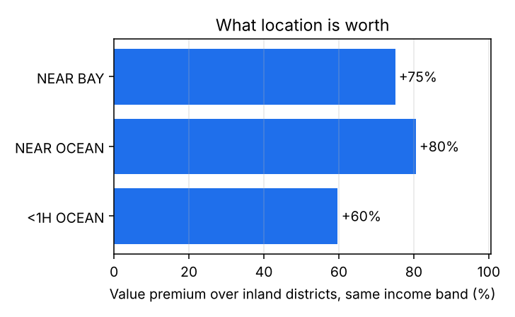
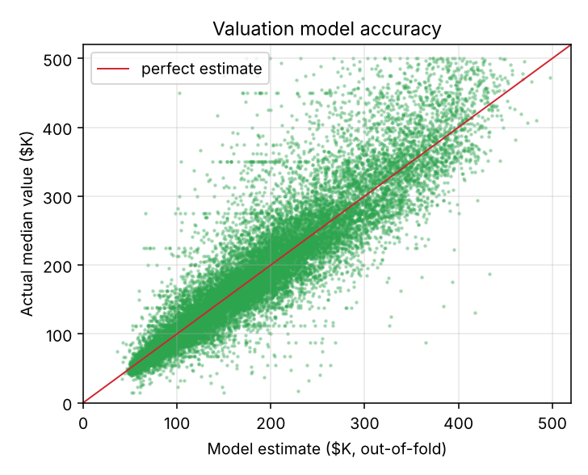
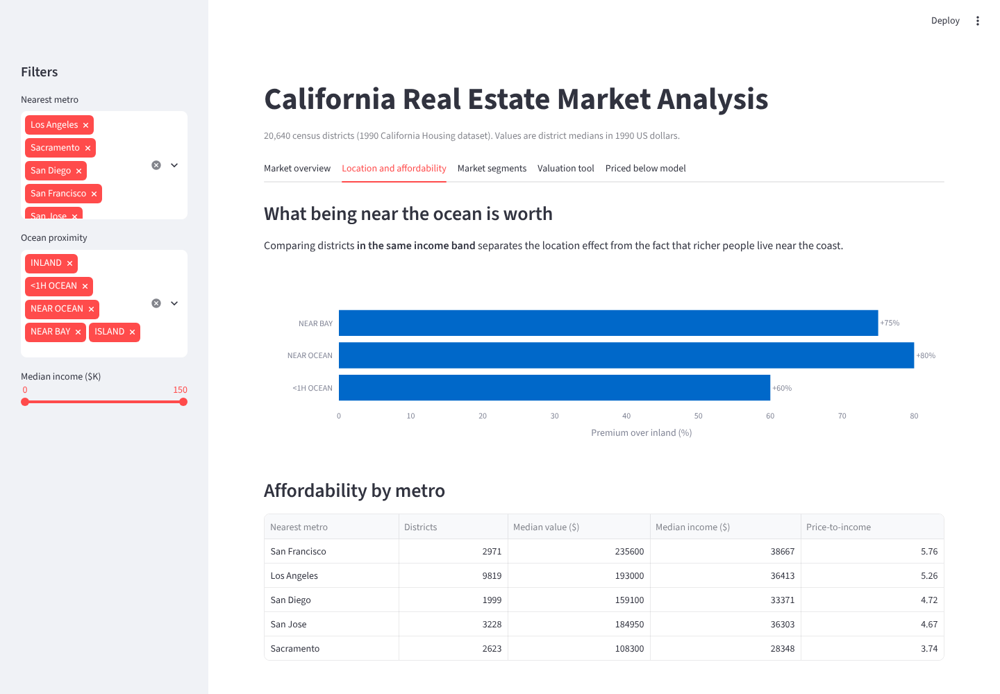

# Real Estate Market Analysis

**Market analysis, a valuation model and an interactive dashboard for 20,640 California districts. It measures what location is really worth, checks how well a price model works in areas it has never seen, and surfaces districts priced well below their estimate.**




## Questions this answers

1. What does the market look like, and how affordable is each metro area?
2. How much is being near the coast worth, once you account for richer people living there?
3. How accurately can district values be estimated, especially in areas the model hasn't seen?
4. Which districts are priced well below what the model expects?

## Data

The California Housing dataset (1990 census, 20,640 districts) with location, age, rooms, population, income and median house value. Details and known quirks are in [data/README.md](data/README.md).

**Cleaning decisions**

- **Missing bedrooms (207 districts):** filled from the typical bedrooms-to-rooms ratio for the same location type.
- **Capped values:** 965 districts sit at the $500,001 census cap. They're excluded from model training and scoring, because their true value is unknown.
- **New features:** rooms and people per household, bedrooms ratio, price-to-income ratio, and distance to the nearest of five metros (San Francisco, Los Angeles, San Diego, San Jose, Sacramento) using the haversine formula.

## Key findings

**Market:** median district value is **$179,700** against a median household income of $35,348, a price-to-income ratio of **4.95**.

**Affordability by metro**

| Nearest metro | Median value | Median income | Price-to-income |
| --- | --- | --- | --- |
| San Francisco | $235,600 | $38,667 | **5.76** |
| Los Angeles | $193,000 | $36,413 | 5.26 |
| San Diego | $159,100 | $33,371 | 4.72 |
| San Jose | $184,950 | $36,303 | 4.67 |
| Sacramento | $108,300 | $28,348 | **3.74** |

**Location premium.** Coastal districts are worth more partly because richer people live there. Comparing districts **within the same income band** isolates the location effect:

| Location | Premium over inland, same income |
| --- | --- |
| Less than 1 hour from the ocean | +60% |
| Near the bay | +75% |
| Near the ocean | +80% |

<p align="center">
  
  
</p>

**Market segments (K-Means):**

| Segment | Districts | Median value | Median income | Distance to metro | Median age |
| --- | --- | --- | --- | --- | --- |
| Premium urban | 6,881 | $279,900 | $45,096 | 21 km | 35 yrs |
| Mid-market suburban | 4,296 | $204,950 | $46,618 | 54 km | 14 yrs |
| Mid-market urban | 4,755 | $150,300 | $26,384 | 15 km | 35 yrs |
| Affordable rural | 4,708 | $91,250 | $24,653 | 130 km | 26 yrs |

The suburban segment has incomes as high as the premium segment but much newer housing farther out, which fits buyers trading distance for space.

## Valuation model

A gradient-boosted regressor (HistGradientBoosting) on the log of value, using location, income, age, density and distance features. I evaluated it two ways:

| Evaluation | MAE | MAPE | R² |
| --- | --- | --- | --- |
| Random 80/20 split | $26,903 | 14.4% | 0.82 |
| **Unseen areas** (5-fold, whole 0.5° grid cells held out) | $38,927 | 22.1% | 0.67 |

The random split looks better because neighbouring districts are similar and end up on both sides of the split. The spatial test is the honest number for valuing districts in a new area.

<p align="center"></p>

## Priced below the model

Every district is valued by a model that **never saw it** (out-of-fold predictions). **479 districts** are priced below 70% of their estimate. These are leads for research rather than buy signals: the gap can reflect housing condition, crime or other things the data doesn't capture. The dashboard lets you change the cut-off and filter by area.

## The dashboard

| Tab | What it shows |
| --- | --- |
| Market overview | KPIs, a price map, the value distribution, income vs value |
| Location and affordability | Location premium at the same income, price-to-income by metro |
| Market segments | Segment profiles and a segment map |
| Valuation tool | Enter a district's details to get a value estimate |
| Priced below model | Adjustable list of districts priced under their estimate |

Filters for metro, ocean proximity and income apply across every tab.



## Run it

```bash
git clone https://github.com/Praveenasuku/Real-Estate-Market-Analysis-.git
cd Real-Estate-Market-Analysis-
python -m venv .venv && source .venv/bin/activate
pip install -r requirements.txt

python -m realestate.report             # retrain and regenerate figures (about 15 seconds)
streamlit run app/streamlit_app.py      # open http://localhost:8501
python -m pytest -q                     # 9 tests
```

With Docker:

```bash
docker build -t real-estate-analysis .
docker run -p 8501:8501 real-estate-analysis
```

## Project structure

```
realestate/
  data.py        load, clean and add features (haversine distance to metros)
  analysis.py    market summary, location premium, affordability, K-Means segments
  model.py       valuation model, random and spatial evaluation, out-of-fold estimates
  report.py      train, then write figures and reports/summary.json
app/streamlit_app.py   interactive dashboard
models/          trained model, metrics, out-of-fold estimates
reports/         figures and summary.json
tests/           data, analysis and model tests
```

## Limitations and next steps

- **Old data:** 1990 values in 1990 dollars. The same pipeline works on current listings data with the same columns.
- **Explain each estimate:** add SHAP values in the valuation tool, so the dashboard shows which features drove each one.
- **Spatial features:** add neighbourhood averages from surrounding districts (spatial lag features) to close the gap between the random and unseen-area scores.

---

**Praveena S**, Generative AI Engineer · [Portfolio](https://praveena-portfolio-two.vercel.app) · [LinkedIn](https://www.linkedin.com/in/praveena-suku/)
